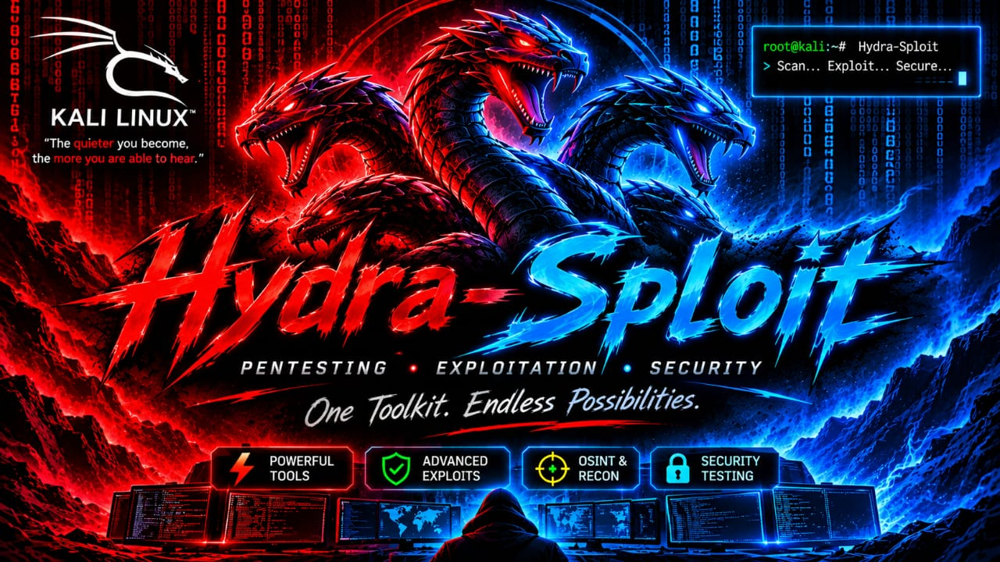

# Hydra-Sploit 2.6
A Python-based cybersecurity toolkit with Post exploitation, Denial-Of-Service, Autonomous reverse shell of netcat.
So this tool only used for authorized penetration testing only or you have explicit permission from owner if you want do hacking to their server. I'm not responsible if you using this for blackhat unethical purpose and make sure also be Good Boyz&Girlz 🫵🏽
# Requirements 🌵
- Python 3
- Kali Linux (Kali linux recommended)
- dependencies listed in requirements.txt
# Installation & Execution 🗡
```bash
git clone https://github.com/HarithBUGbounty/Hydra-Sploit.git
apt install python3 python3-pip netcat metasploit-framework -y
pip3 install -r requirements.txt
chmod +x Hydra-Sploit.py
./Hydra-Sploit.py
```
# Supported Platform
- Kali linux
# Python Package (If your kali linux python outdated)
- sudo apt update && sudo apt full-upgrade -y
- pipx upgrade all
# Virtual Packages Environment
- pip list --outdated --format=freeze | grep -v '^\-e' | cut -d = -f 1 | xargs -n1 pip install -U
